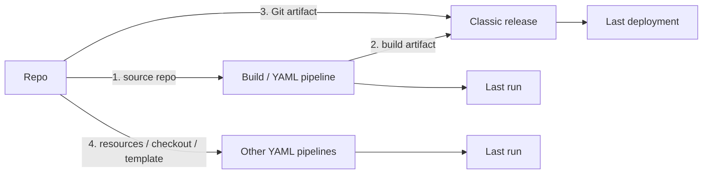
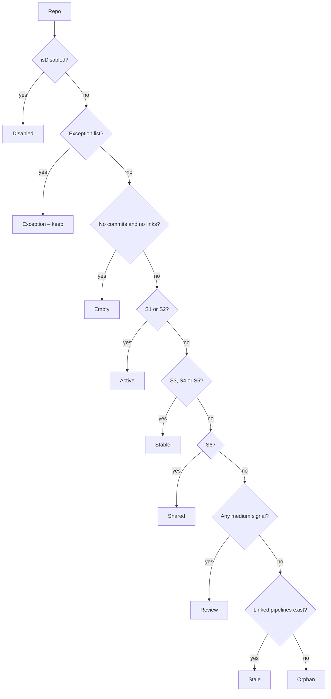
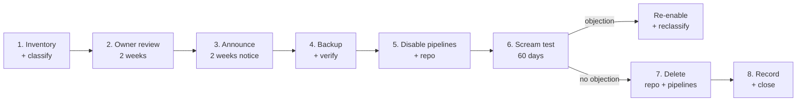

# Identifying & Archiving Unused Azure Repos

> **Page info**
> | | |
> |---|---|
> | **Owner** | DevOps Guild |
> | **Status** | DRAFT – for review |
> | **Scope** | ~365 Azure Repos across 3 Azure DevOps tenants, ~3,000 classic + YAML pipelines |
> | **Related** | Classic → YAML Pipeline Migration: Team Engagement & Process |
> | **Last updated** | 2026-10-26 |

---

## 1. TL;DR

- **No commits ≠ unused.** A repo can be untouched for years while its pipelines still build on a schedule or releases keep redeploying an old build.
- A repo is **in use** if, within the look-back window, **any pipeline built from it, deployed its output, or consumed it as a secondary repo**.
- Classify every repo from **in-use signals** (strong / medium / weak) into one of: **Active, Stable, Shared, Review, Stale, Orphan, Empty, Disabled**.
- Archive **reversibly, in waves**: owner review → announce → **backup** → **disable** → scream test → delete. Never retire Active, Stable or Shared repos.
- Some usage is invisible to Azure DevOps (external clones). That is why we **disable before we delete**.

---

## 2. Repo activity signals

| Signal | API (per repo) | Unused indicator |
|---|---|---|
| Last push | `GET _apis/git/repositories/{id}/pushes?$top=1` | No push in look-back window |
| Last commit (any branch) | `GET .../refs` → tip commit date per branch | All branches older than window |
| PR activity | `GET .../pullrequests?searchCriteria.status=all&$top=1` | No PR in window |
| Empty repo | `GET _apis/git/repositories` → `size == 0` or no `defaultBranch` | Empty = immediate candidate |
| Already disabled | `isDisabled` on the repository object | Already archived |
| Branch policies | `GET _apis/policy/configurations` (scoped to repo) | Policies present suggest active ownership |

> Repo activity alone is **not** sufficient to retire a repo. Always combine with pipeline usage (Section 3).

---

## 3. Pipeline usage signals

A repo can be linked to pipelines in four ways. Check all four.

### 3.1 Repo is the source of a build (classic or YAML)

| Check | API |
|---|---|
| Any run in window | `GET {org}/{project}/_apis/build/builds?repositoryId={repoId}&repositoryType=TfsGit&minTime={windowStart}&$top=1` |
| Definitions bound to the repo | `GET .../_apis/build/definitions?repositoryId={repoId}&repositoryType=TfsGit&includeLatestBuilds=true` |

- Scheduled builds with no code changes still show up as runs.
- Keep the definition IDs for 3.2.

### 3.2 Release deploys a build produced from the repo

The "no commits, still deployed" case: releases redeploy an existing build artifact.

| Check | API |
|---|---|
| Release definitions consuming those builds | `GET vsrm.../_apis/release/definitions?$expand=artifacts` → artifacts with `type == "Build"` and `definitionReference.definition.id` ∈ build definition IDs from 3.1 |
| Last deployment | `GET vsrm.../_apis/release/deployments?definitionId={releaseDefId}&queryOrder=descending&$top=1` |
| YAML deployments to Environments | `GET .../_apis/distributedtask/environments/{envId}/environmentdeploymentrecords` → match `definition.id` |

- Check **all projects in the org**: releases may consume builds from other projects.

### 3.3 Repo is a direct Git artifact of a classic release

| Check | API |
|---|---|
| Release definitions with Git artifact | Same call as 3.2 → artifacts with `type == "Git"` and `definitionReference.definition.id == {repoId}` |
| Last deployment | Same as 3.2 |

### 3.4 Repo is consumed by another pipeline

Typical for template repos, shared libraries, infra/config repos.

| Check | API / method |
|---|---|
| Pipelines authorised to use the repo | `GET .../_apis/pipelines/pipelinePermissions/repository/{projectId}.{repoId}` (requires *Protect access to repositories in YAML pipelines*) |
| Repos actually used by a run | `GET .../_apis/pipelines/{pipelineId}/runs/{runId}` → `resources.repositories` |
| YAML references | Code Search: `POST almsearch.dev.azure.com/{org}/{project}/_apis/search/codesearchresults` for the repo name in `*.yml`/`*.yaml` (`resources.repositories`, `checkout:`, `template: ...@alias`) |
| Classic definitions & task groups | Search definition JSON (incl. inline scripts) for repo name / clone URL (`git clone` in script tasks) |

> Run 3.4 **once per org** (scan all YAML / permissions) rather than per repo.

---

## 4. Signals that a repo is in use

Signals are graded by how strongly they prove the repo is needed. **Any strong signal within the look-back window = keep.**

### 4.1 Strong – proves use

| # | Signal | Source |
|---|---|---|
| S1 | Push or completed PR in window | Section 2 |
| S2 | Open (active) PR | `pullrequests?searchCriteria.status=active` |
| S3 | Build/YAML run in window with the repo as source (incl. scheduled runs) | 3.1 |
| S4 | Release or Environment deployment in window of a build produced from the repo | 3.2 |
| S5 | Release deployment in window with the repo as a Git artifact | 3.3 |
| S6 | Run in window that checked out the repo or loaded templates from it | 3.4 (`resources.repositories` on run) |

### 4.2 Medium – likely use, needs owner confirmation

| # | Signal | Source |
|---|---|---|
| M1 | Enabled pipeline/release definition with CI trigger or schedule, but no recent runs (no changes to trigger it) | Build/release definitions |
| M2 | Release created in window but not yet deployed (pending approval / gate) | `release/releases?definitionId=` |
| M3 | Referenced statically by another repo's YAML (`resources.repositories`, `template: @alias`) even if that pipeline hasn't run | 3.4 YAML scan |
| M4 | Repo authorised in pipeline permissions for a pipeline | 3.4 `pipelinePermissions` |
| M5 | Service hook / webhook subscriptions targeting the repo (external consumers, e.g. Jenkins) | `_apis/hooks/subscriptions` |
| M6 | Published as a **code wiki** | `_apis/wiki/wikis` (`type == codeWiki`, `repositoryId`) |
| M7 | Has forks, or is a fork of an active repo | `_apis/git/repositories/{id}/forks/{collectionId}` |
| M8 | New branches or tags (e.g. release tags) in window | `refs?filter=tags/` + commit dates |

### 4.3 Weak – context only, never decisive

| # | Signal |
|---|---|
| W1 | Branch policies / required reviewers configured |
| W2 | Non-trivial size or many branches |
| W3 | Work items linked to commits/PRs (historic) |
| W4 | Name suggests shared use (`*-templates`, `*-shared`, `*-common`, `*-infra`, `*-config`) |

---

## 5. Classification of each repo

### 5.1 Decision flow (first match wins)

### 5.2 Statuses

| Status | Meaning | Action | Archive wave |
|---|---|---|---|
| **Active** | Code is changing (push/PR in window) | Keep | – |
| **Stable** | No code changes, but still built or deployed | **Keep** – app is live | – |
| **Shared** | Consumed by other pipelines (templates, libraries, infra/config) | **Keep** | – |
| **Exception** | Owner/compliance requires retention | Keep; review annually | – |
| **Review** | Only medium signals | Owner decides; default **keep** if no answer | Wave 3 (only if owner agrees) |
| **Stale** | Linked pipelines exist but none ran/deployed in window | Retire repo **and** its pipelines together | Wave 2 |
| **Orphan** | No pipeline links, no activity in window | Retire | Wave 2 |
| **Empty** | No commits, no pipelines | Retire (fast track) | Wave 1 |
| **Disabled** | Already disabled | Back up + delete per retention | Wave 1 |

**Look-back window:** _TBD (6 / 12 / 24 months)._ It must not exceed build/release **retention** (see Section 7).

Stale / Orphan / Empty repos feed the **retire** path of the Classic → YAML migration: their classic pipelines are retired, not migrated.

### 5.3 Per-repo inventory record

One row per repo across all 3 tenants:

| Group | Fields |
|---|---|
| Identity | tenant, org, project, repo id, repo name, default branch, size, isDisabled |
| Activity | last push, last completed PR, open PR count, last tag/branch created |
| Pipeline usage | linked build defs (count, last run), linked release defs (count, last deployment), consumer pipelines (count, last run) |
| Signals | strong signals (S1–S6), medium signals (M1–M8), weak signals (W1–W4) |
| Ownership | suggested owner (top committers / PR authors in last 24 months, project admins, pipeline `requestedFor`), confirmed owner |
| Outcome | status, recommended action, wave, owner decision, decision date, backup location, disabled date, deleted date |

---

## 6. Archive process (recommended)

### 6.1 Principles

- **Reversible first** – every step can be undone until the final delete.
- **Backup before disable** – a disabled repo can't be cloned, so the backup is taken first (and is final, since a disabled repo can't change).
- **Owner-approved, evidence-backed** – every decision is recorded against the inventory row.
- **In waves, lowest risk first** – Empty/Disabled → Orphan/Stale → Review. Active, Stable, Shared and Exception repos are never archived.
- **Repo and its pipelines retire together** – no orphaned pipelines pointing at disabled repos.

### 6.2 Flow

### 6.3 Steps

| # | Step | How | Exit criteria |
|---|---|---|---|
| 1 | **Inventory & classify** | Collect Section 2–4 signals for all repos in all 3 tenants; apply Section 5 | Every repo has a status and wave |
| 2 | **Owner review** | Send each team its Stale / Orphan / Review list with evidence; owner replies *archive* / *keep* / *exception*. No reply → escalate to project admin. Review repos with no reply stay **kept** | Decision recorded per repo |
| 3 | **Announce** | Post in engineering channel + email to project contributors: list, dates, how to object | Notice period elapsed |
| 4 | **Backup** | `git clone --mirror` → `git bundle create` → `git bundle verify` → upload to Azure Blob (immutable, retention _TBD_) with SHA-256 checksum. Alongside: metadata JSON (inventory row), build/release definition JSON, branch policies, repo permissions (ACL snapshot); PR threads export if audit requires | Bundle verified, checksum stored |
| 5 | **Disable** | Pipelines: set build definitions `queueStatus: disabled`, disable release definitions. Repo: `PATCH _apis/git/repositories/{id}` `{"isDisabled": true}` | Repo not cloneable; pipelines can't run |
| 6 | **Scream test** | Wait 60 days (30–90). Watch for re-enable requests and **failed runs referencing the repo** (missed consumers). Any objection → re-enable, reclassify, add to exceptions if needed | Window passed with no objections |
| 7 | **Delete** | Delete pipeline/release definitions, then `DELETE _apis/git/repositories/{id}` (30-day recycle bin). Optional: keep long-term disabled instead of deleting | Repo in recycle bin |
| 8 | **Record & close** | Update inventory row (backup location, dates); close tracking work item | Row closed |

### 6.4 Waves

| Wave | Statuses | Owner review | Scream test |
|---|---|---|---|
| 1 | Empty, Disabled | Notify only | 30 days |
| 2 | Orphan, Stale | Required | 60 days |
| 3 | Review (owner agreed) | Required, explicit *archive* | 90 days |

### 6.5 Restore runbook

| When | How |
|---|---|
| During scream test | `PATCH _apis/git/repositories/{id}` `{"isDisabled": false}`; re-enable pipelines |
| Within 30 days of delete | Restore from recycle bin: `PATCH _apis/git/recycleBin/repositories/{id}` `{"deleted": false}`; re-create pipelines from exported JSON |
| After recycle bin expiry | Create empty repo → `git clone <bundle>` → `git push --mirror`; re-apply branch policies/permissions and pipelines from exported JSON |

### 6.6 Roles

| Activity | DevOps Guild | Repo owner / team | Project admin |
|---|---|---|---|
| Inventory & classification | **Executes** | Informed | Informed |
| Archive decision | Recommends | **Decides** | Decides if owner unknown |
| Backup, disable, delete | **Executes** | Informed | Informed |
| Objection / restore | **Executes** | Requests | Requests |

**Permissions:** PAT scope *Code (Read, write & manage)*, *Build (Read & execute)*, *Release (Read, write, execute & manage)*; account needs *Delete or disable repository* on each project.

**Alternative:** a dedicated "Archive" project per org (import repo there, delete original – ADO has no cross-project move). Not recommended: more effort than disable, and the data still lives in ADO.

---

## 7. Gaps & limitations

| Gap | Impact | Mitigation |
|---|---|---|
| **External clones** (Terraform module sources, git submodules, Jenkins/GitHub Actions, developer tooling) | Not visible via any ADO API; ADO has no per-repo clone/fetch telemetry and audit log doesn't record them | Disable first, wait 30–90 days before delete |
| **Retention policies** | Runs/releases older than retention are gone; a "no runs" result may just mean "deleted runs" | Keep look-back window ≤ retention; check retention per project |
| **Code Search not installed** | Section 3.4 YAML search unavailable | Scan YAML files directly via Items API |
| **Repo pipeline permissions not enforced** | `pipelinePermissions` may be empty even when used | Rely on run `resources.repositories` + YAML scan |
| **Cross-org / cross-tenant references** | Pipelines in one tenant consuming a repo in another (via service connection) aren't found by per-org scans | Search all 3 tenants for repo name / URL |
| **Dynamic references** (repo name built from variables, scripted `git clone`) | Missed by static search | Search inline scripts for clone URLs; rely on scream test |
| **PR discussions, wiki, work item links** | Not included in a git bundle | Export separately if required for audit |
