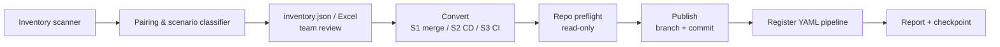

# Plan: Publish Migrated YAML into Target Repos (multi-org, 3,000+ pipelines)

> **Status:** DRAFT  
> **Extends:** [plan.md](plan.md) (local batch conversion) – this plan adds inventory, build↔release pairing, and publishing to Azure Repos.

---

## 1. Goal

Turn every classic build / classic release into YAML and **land it in the correct Azure Repos repo**, across all orgs/projects, safely and resumably:

- Commit YAML to a **migration branch** (team raises the PR).
- Register the **YAML pipeline in ADO** (enabled).
- Produce a per-team report for the engagement process (Discover → Assess → Migrate).

## 2. Decisions (agreed)

| Topic | Decision |
|---|---|
| Repo hosting | Azure Repos (Git) only. TFVC / GitHub / external Git → skipped + flagged |
| Auth | PAT per org (`config/pats.yml`) |
| Delivery | Push to feature branch only; **team raises the PR** |
| File path | `.pipelines/<pipeline-name>.yml` |
| Build + release both classic | **Merged into one multi-stage YAML** in the build's repo |
| ADO YAML pipeline | Created **enabled** |
| Template repo | Referenced via **service connection** in `resources.repositories` |
| File/branch already exists | **Skip + flag** for review (never overwrite) |
| Build feeding multiple classic releases | **One merged YAML** (all releases' stages in the build's file) |
| Triggers | Always `trigger: none`; original classic triggers/schedules emitted as a **commented block** with a note to enable at cut-over |
| S2 (YAML build + classic release) | Separate `-cd.yml` is the **long-term** layout, not a stop-gap |

## 3. Migration scenarios

The inventory classifies every build/release into a **migration unit** keyed on the build definition. The scenario decides what is generated.

| # | Build | Release | Action | Output file(s) |
|---|---|---|---|---|
| **S1** | Classic | Classic | **Merge** build + release into one multi-stage YAML (CI stage + one `deployment` stage per release environment) | `.pipelines/<build-name>.yml` |
| **S2** | **YAML (exists)** | Classic | Migrate **release only** → CD-only YAML that consumes the existing YAML build via `resources.pipelines` (trigger on completion). Existing YAML file is **not modified** | `.pipelines/<release-name>-cd.yml` |
| **S3** | Classic | **YAML (exists)** or none | Migrate **build only** → CI YAML. If a YAML pipeline consumes this classic build via `resources.pipelines`, flag it: its `source:` must be repointed to the new YAML build | `.pipelines/<build-name>.yml` |
| **S4** | YAML | YAML / none | Nothing to do → status `already-yaml` | – |
| **S5** | – (no build artifact) | Classic | Release uses Git/NuGet/other artifact or none → `needs-target`; target repo taken from Excel override, else skipped | `.pipelines/<release-name>-cd.yml` (if target given) |
| **S6** | Classic, non-Azure-Repos source (TFVC/GitHub/other) | any | Skip + flag `unsupported-repo` | – |

### 3.1 Detection rules

- **Build is YAML vs classic:** build definition `process.type` → `1` = designer (classic), `2` = YAML. For YAML builds also capture `process.yamlFilename` and `repository`.
- **Release → build pairing:** release `artifacts[]` where `type == "Build"` → `definitionReference.definition.id` + `definitionReference.project.id`. The artifact marked `isPrimary` (or the first one) decides the target repo.
- **Release "already YAML":** there is no classic release referencing the build. Optional deeper check: scan YAML pipelines' files for `resources.pipelines[].source` matching the classic build name (feeds the S3 repoint flag).
- **Disabled / stale definitions:** capture `queueStatus`, last run date; route to the *retire* list instead of migrating (per engagement process §6).

### 3.2 Pairing edge cases

| Case | Handling |
|---|---|
| Release has multiple build artifacts | Primary artifact = target repo / CI stage; others become `resources.pipelines` entries |
| One build feeds multiple classic releases | **One merged YAML**: CI stage once, then each release's environments as stages, named `<release>_<environment>` to avoid collisions; each release's stage chain depends only on CI. For S2 the same applies to a single `-cd.yml` |
| Release artifact points to build in another project | Target = build's project/repo; flag `cross-project` |
| Release artifact points to build in another org | Flag `cross-org`; skip merge, treat release as S5 |
| Release artifact build definition deleted | Flag `orphan-artifact`; treat as S5 |
| Same repo hosts several units | All files committed in **one commit on one branch** per repo |

## 4. Architecture changes



| Component | Location | Change |
|---|---|---|
| Inventory scanner | `engine/inventory/scanner.py` (new) | List builds (with `process.type`, repository) and releases (with artifacts) per org/project |
| Pairing / classifier | `engine/inventory/pairing.py` (new) | Build `MigrationUnit`s, assign scenario S1–S6, edge-case flags |
| Models | `engine/models.py` | Add `RepoTarget`, `MigrationUnit`, `Scenario` enum, `PublishResult` |
| Merger | `engine/transformer/merge_build_release.py` (new) | Combine CI stage + release environments into multi-stage YAML; CD-only variant for S2 |
| Publisher | `engine/publisher/repo_publisher.py` (new) | Preflight, branch, commit, pipeline registration (wraps existing client methods) |
| API client | `engine/extractor/azure_api_client.py` | Reuse `push_file_to_branch`, `_ensure_branch`, `upsert_yaml_pipeline`; add `get_item_exists`, `list_service_endpoints`, `authorize_pipeline_resource` |
| CLI | `scripts/batch_migrate.py` | New subcommands: `inventory`, `convert`, `publish`, `rollback`; filters `--org/--project/--repo/--scenario` |
| Config | `config/publish.yml` (new) | Branch name, path pattern, pipeline folder, template repo/tag, service connection name pattern, concurrency |

## 5. Phases

### Phase 0 – Fix blockers
- [ ] Fix `select_extractor()` `mcp_endpoint` signature mismatch with `engine/service.py`.
- [ ] Add PAT scope check: Build (Read & execute), Release (Read), Code (Read & write), Service Connections (Read), Task Groups (Read).

### Phase 1 – Inventory & pairing (read-only)
- [ ] Scan all orgs/projects in `pats.yml`; paginate with continuation tokens; honour `Retry-After`.
- [ ] Classify each unit into S1–S6 with flags (§3).
- [ ] Output `output/inventory.json` + `output/inventory.xlsx` (one row per unit: org, project, repo, build id/name/type, release ids/names, scenario, flags, last run).
- [ ] Excel supports overrides: `target_repo`, `include` (Y/N), `split_releases` (Y/N).
- **Exit:** inventory reviewed with pilot teams.

### Phase 2 – Conversion per scenario
- [ ] **S1 merge:** CI stage from build; release environments → `deployment` stages (in rank order, honouring `conditions` / environment dependencies); `download: current` for the build artifact.
- [ ] **Triggers (all scenarios):** emit `trigger: none` plus the converted classic triggers/schedules as a commented block, e.g.
  ```yaml
  # TODO(cut-over): replace `trigger: none` with the triggers below once ready for cut-over.
  # Classic schedules converted to UTC.
  # trigger:
  #   branches:
  #     include: [main]
  # schedules:
  #   - cron: "0 2 * * 1-5"
  #     branches: { include: [main] }
  trigger: none
  ```
- [ ] **S2 CD-only (long-term layout):** `trigger: none`, `resources.pipelines` → existing YAML build (`source` = YAML pipeline name) with **no active resource trigger**; classic release CD trigger/branch filters emitted as a commented `trigger:` under the resource; deployment stages as above.
- [ ] **S3 CI-only:** existing converter; flag downstream YAML consumers to repoint.
- [ ] Template reference block via service connection:
  ```yaml
  resources:
    repositories:
      - repository: templates
        type: git
        name: <TemplatesProject>/pipeline-templates
        endpoint: <template-service-connection>
        ref: refs/tags/<version>
  ```
- [ ] Release controls (approvals, gates, deployment windows, manual interventions) emitted into the report as **Environment checks to configure** (not YAML).
- [ ] Classic schedules converted to **UTC** with a flag.
- [ ] Validate every generated file with the existing validator.

### Phase 3 – Repo preflight (read-only, also the dry-run)
Per target repo:
- [ ] Repo exists, is Git, default branch readable.
- [ ] Target file absent on default branch **and** migration branch → else `skip: file-exists`.
- [ ] Migration branch absent or created by the tool (commit author check) → else `skip: branch-exists`.
- [ ] Template service connection exists in project.
- [ ] YAML pipeline name not already taken in target folder.

### Phase 4 – Publish
- [ ] Create `migration/classic-to-yaml` from default branch HEAD.
- [ ] One commit per repo containing all its unit files; message includes classic build/release IDs.
- [ ] Register YAML pipeline per file via `upsert_yaml_pipeline()` (folder `\migrated\<original-folder>`, default branch = migration branch, enabled).
- [ ] Authorize the template service connection for the new pipeline (avoid first-run permission prompt).
- [ ] Record commit id, branch URL, pipeline id/URL in the report.

### Phase 5 – Scale, resumability, rollback
- [ ] Worker pool with per-org concurrency limit (configurable, default 4).
- [ ] Step-level checkpoint per unit: `inventoried → converted → preflighted → pushed → registered`; `--resume` continues from the last completed step (idempotent, no duplicate commits).
- [ ] `rollback` subcommand: delete migration branch + created pipelines using IDs from the report.
- [ ] PAT expiry check before each run.

### Phase 6 – Reporting
- [ ] `migration-report.csv` columns: org, project, repo, scenario, build id/type, release ids, file path, branch, commit id, yaml pipeline id/url, status, skip/flag reasons, env checks to configure, schedule-UTC flag, triggers_pending, downstream-repoint flag.
- [ ] Per-team summary (grouped by project/repo) for the migration work item; team uses it to raise the PR.

## 6. Risks

| # | Risk | Mitigation |
|---|---|---|
| R1 | **Double deployments:** pipeline is created enabled; after PR merge YAML CI/CD runs alongside classic | All triggers generated as `trigger: none` (commented originals); manual runs only until cut-over |
| R2 | Cross-org template consumption via service connection may not work for `type: git` templates | Spike in Phase 0 with one real pipeline before scaling |
| R3 | Teams forget to enable triggers at cut-over | Cut-over checklist item + report column `triggers_pending`; commented block contains the exact triggers to restore (incl. `resources.pipelines[].trigger.branches` for S2) |
| R7 | Merged YAML with many releases becomes large / stage name clashes | `<release>_<environment>` stage naming; flag units with > N releases for manual review |
| R4 | S3 downstream YAML consumers break when classic build is decommissioned | Flag + list consumers in report; repoint before decommission |
| R5 | API throttling at 3,000+ definitions | Per-org concurrency, `Retry-After`, step checkpoints |
| R6 | PAT expiry mid-run | Preflight expiry check; resume support |

## 7. Open questions

- **Q4 (open):** Should disabled / not-run-in-N-days definitions be auto-routed to *retire*? If so, what N?

**Resolved:** Q1 → one merged YAML · Q2 → `trigger: none` + commented originals · Q3 → separate `-cd.yml` is long-term.
