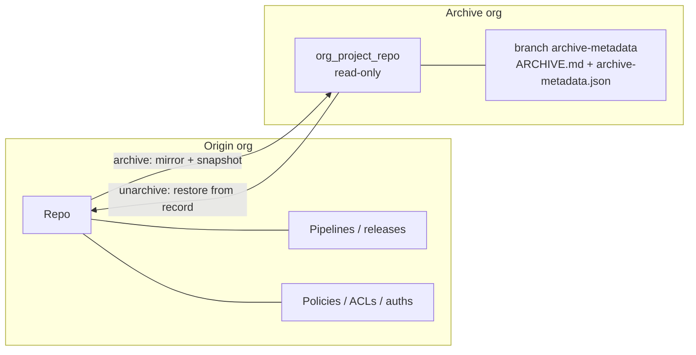
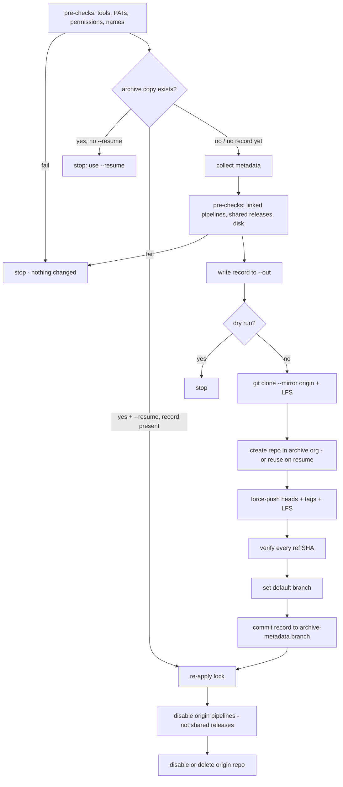
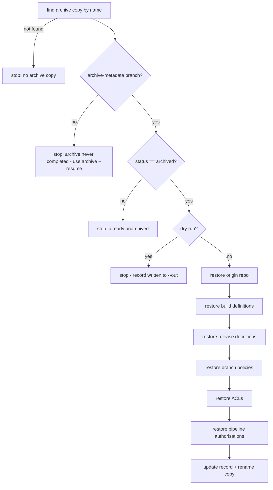

# repo_archive.py – Logic & Rationale

> Companion to [identify-and-archive-unused-repos.md](identify-and-archive-unused-repos.md) §6.7.
> Code: [scripts/repo_archive.py](scripts/repo_archive.py) · Pipeline: [pipelines/repo-archive.yml](pipelines/repo-archive.yml)

---

## 1. What it does

| Action | In one line |
|---|---|
| **archive** | Copy a repo from its origin org into a central **archive org**, record everything needed to restore it, lock the copy read-only, then switch off the origin repo and its pipelines. |
| **unarchive** | Read that record and put the origin repo back exactly as it was – repo, branches, policies, permissions, pipelines, pipeline authorisations – then mark the archive copy as unarchived. |



---

## 2. Design principles

| Principle | How the script applies it | Why |
|---|---|---|
| **Reversible by default** | Origin repo is **disabled**, not deleted (`--source-action disable`). | Disabled repos keep id, policies, ACLs and pipeline links → unarchive is a simple re-enable. |
| **Record before change** | All metadata is collected and the record is written **before** anything is modified. | If a later step fails, nothing is lost and the record explains what existed. |
| **Verify, don't assume** | Every branch/tag SHA is compared after each push (`verify_refs`). | A silent partial push would make the archive useless. |
| **Self-describing archive** | Record lives **inside** the archive copy on an orphan branch. | The archive can be understood and restored years later without external storage or the original pipeline run. |
| **Original history untouched** | Record is on a separate orphan branch `archive-metadata`; source branches are pushed as-is. | Commit SHAs stay identical, so restored repos match the original byte-for-byte. |
| **Dry run first** | `--dry-run true` is the default; pipeline always runs a Plan stage first. | Reviewers see exactly what will be archived before approving. |
| **Fail fast** | Pre-checks (tools, PATs, permissions, names, pipelines, disk) run before anything is changed. | Config problems surface in the Plan stage, not half-way through an archive. |
| **Resumable & idempotent** | `--resume` continues a failed archive; retire and restore steps skip work already done. | A transient failure never needs manual clean-up. |
| **Don't break other teams** | Repos with pipelines are blocked by default; shared release pipelines are never disabled. | Pipelines are retired in a separate process; archiving must not stop other apps deploying. |
| **No secrets at rest** | Only names/types of service connections and variable groups are stored; secret-looking hook inputs are dropped. | The record is readable by anyone with archive access. |
| **Single file, one dependency** | Only `requests` + `git`. | Easy to run locally or on any agent. |

---

## 3. Authentication

- Two PATs: `SOURCE_PAT` (origin org) and `ARCHIVE_PAT` (archive org). Origin and archive can be in different Entra tenants – PATs are org-scoped so this just works.
- REST calls use HTTP Basic with the PAT.
- Git calls inject `Authorization: Basic …` via `GIT_CONFIG_*` **environment variables**, so the PAT never appears in the process list, command line, or `.git/config`.
- In a pipeline (`TF_BUILD` set) the base64 header value is registered with `##vso[task.setsecret]`, because the agent only masks the raw PAT, not its encoded form.
- A `203` or HTML response is treated as an auth failure (ADO's typical response for an invalid PAT).

---

## 4. Archive flow



### 4.0 Pre-checks

Run in every mode (including dry run / Plan stage). Any **fail** stops the run before anything is changed; **warn** is reported and recorded in `ARCHIVE.md`.

| Check | Fail / warn | Why |
|---|---|---|
| `git >= 2.31` on PATH | fail | Credentials are passed via `GIT_CONFIG_COUNT` env vars (git 2.31+). |
| `git-lfs` on PATH | warn | LFS objects would not be copied. |
| Both PATs can read security namespaces | fail | Needed for permission snapshot, lock and permission checks. |
| Source repo found and enabled | fail (warn on `--resume`) | Disabled repos can't be cloned. |
| Source repo permissions: Read, Delete/disable repository | fail | Needed to clone and retire. |
| Archive project found | fail | Destination must exist. |
| Archive copy name free | fail unless `--resume` | Fail fast, before the expensive org-wide pipeline scan. |
| Archive project permissions: Create repository, Contribute, Manage permissions | fail | Create, push, lock. |
| Archive `Valid Users` groups resolvable | fail | Read-only lock targets these groups. |
| **No linked pipelines** | fail unless `--allow-pipelines` | Repos with pipelines are not expected archive candidates; pipelines are retired separately. With the flag it becomes a warning and *Edit build/release definition* permission is checked per project. |
| Release pipelines exclusive to this repo | warn | Shared releases are left enabled (see 4.5). |
| Free disk for mirror | fail | Needs ~2× repo size + 200 MiB in the temp dir. |

### 4.0.1 Resume (`--resume`)

If a run fails part-way, rerun with `--resume`:

| State found | What resume does |
|---|---|
| Archive copy exists, **no** `archive-metadata` branch | Origin is untouched (retire runs last), so metadata is re-collected, refs are force-pushed into the existing copy, verified, record committed, locked, origin retired. |
| Archive copy **and** record exist | Uses the **recorded** snapshot (not a fresh one – origin may be partly retired already), re-applies the lock and re-runs retire. Retire is idempotent: already-disabled items are skipped, a missing repo on delete is fine. |

Without `--resume`, an existing copy is a hard stop, so a repo can't be archived twice by accident.

### 4.1 Collect (`collect`)

| What | API | Why it's needed |
|---|---|---|
| Repo object | `git/repositories?includeHidden=true` | id, default branch, size, URLs. Refuses disabled repos (can't be cloned). |
| Branches & tags | `git/repositories/{id}/refs` | Used to verify the copy and the restore. |
| Branch policies | `git/policy/configurations?repositoryId=` | Only repo-scoped ones; project-wide policies are untouched by archiving. |
| Permissions (ACLs) | `accesscontrollists/{GitNamespace}?token=repoV2/{proj}/{repo}&recurse=true` | `recurse` includes branch-level ACLs. |
| Identity names | `vssps …/identities?descriptors=` | Makes the doc readable (`[Proj]\Contributors` instead of a SID). |
| Repo pipeline permissions | `pipelines/pipelinePermissions/repository/{proj}.{repo}` | Which YAML pipelines may check out this repo. |
| Build definitions | `build/definitions?repositoryId=` – **every project** | YAML pipelines in other projects can build this repo. Full JSON kept for recreation. |
| Release definitions | `release/definitions?$expand=artifacts` – **every project** | Matches Git artifacts = this repo, or Build artifacts = a build def found above. Marked **shared** if it also has artifacts from elsewhere. |
| Pipeline resources | service connections, variable groups, secure files, environments, agent queues + their `pipelinePermissions` | Recorded if authorised for, or referenced by (GUID match in definition JSON), a linked pipeline. |
| Service hooks | `hooks/subscriptions` filtered by `publisherInputs.repository` | External consumers (Jenkins, webhooks). |
| Code wikis | `wiki/wikis` filtered by `repositoryId` | A wiki published from the repo breaks if the repo goes away. |

> **Git security namespace id is resolved at runtime** (`Ado.git_ns`) from `_apis/securitynamespaces` by name `Git Repositories`, rather than hard-coded, so it works in every org.

### 4.2 Copy

- `git clone --mirror` gets every ref; only `refs/heads/*` and `refs/tags/*` are pushed (ADO rejects `refs/pull/*` and other internal refs).
- `git lfs fetch --all` / `git lfs push --all` if `git-lfs` is installed; otherwise a warning is logged.
- `verify_refs` compares the sorted `(ref, sha)` list of source vs copy and fails on any difference.

### 4.3 Record

- A fresh repo is `git init -b archive-metadata`, `ARCHIVE.md` and `archive-metadata.json` are written, committed by `Repo Archive Pipeline`, and pushed as a **root (orphan) commit**.
- Default branch of the copy is set to the original default branch, so browsing the copy looks like the original; reviewers switch to `archive-metadata` to read the record.
- The same two files are written to `--out` (published as a pipeline artifact).

### 4.4 Lock read-only (`set_readonly`)

Adds a **deny** ACE on the archive copy for `[project]\Project Valid Users` and `[org]\Project Collection Valid Users`:

| Denied | Bit |
|---|---|
| Contribute | 4 |
| Force push | 8 |
| Create branch | 16 |
| Create tag | 32 |
| Manage notes | 64 |
| Bypass policies when pushing | 128 |
| Contribute to pull requests | 16384 |
| Bypass policies when completing PRs | 32768 |

**Read** is not denied – the archive stays browsable and cloneable. Deny wins over allow in ADO, so this blocks writes for everyone, while admins can still edit permissions (not denied) if an exception is needed.

### 4.5 Retire origin (`retire_source`)

1. Build definitions → `queueStatus: disabled` (can't be queued; CI/schedules stop).
2. Release definitions → `isDisabled: true` – **only if every artifact comes from this repo**. A *shared* release (also deploys other repos' builds) is left enabled so other apps keep deploying; it is flagged in the record and pre-check output.
3. Repo → `isDisabled: true` (default) or `DELETE` (goes to the 30-day recycle bin).

Done **last**, so a failure anywhere earlier leaves the origin fully working. Each step skips items already in the target state, so `--resume` can safely re-run it.

---

## 5. Unarchive flow



Build definitions are restored before policies because build-validation policies reference build definition ids that may have changed.

### 5.1 Restore repo (`restore_repo`) – three paths, cheapest first

| Origin state | Action | Repo id |
|---|---|---|
| Still exists (disabled) | `PATCH isDisabled: false` | same |
| In recycle bin | `PATCH recycleBin/repositories/{id} deleted:false` | same |
| Gone | Create repo with original name, mirror from archive copy (minus `archive-metadata`), push heads/tags/LFS | **new** |

Refs are verified against the record in all cases; default branch is restored.
If a *different* repo already uses the original name, it stops rather than overwrite.

### 5.2 Re-apply configuration

| Item | Logic |
|---|---|
| **Build definitions** | GET by id → if missing try undelete (`PATCH ?deleted=false`) → else look up by name + folder (catches one recreated by an earlier failed unarchive) → else recreate from stored JSON. Repo id is remapped if it changed; `queueStatus` set back to the recorded value. Produces an `id_map` old→new definition id. |
| **Release definitions** | GET by id → else look up by exact name + folder → update, or recreate from stored JSON. Git artifacts remapped to the new repo id, Build artifacts remapped via `id_map`. `isDisabled` set back to recorded value (shared releases keep their current state). |
| **Branch policies** | Skipped if a policy with the same id still exists (repo kept its id). Otherwise recreated with repo id and build-validation `buildDefinitionId` remapped. |
| **ACLs** | Re-applied per token with `POST accesscontrollists` (tokens rewritten to the new repo id). If a token fails (e.g. an identity no longer exists), it retries entry by entry and turns failures into warnings, so one bad entry doesn't stop the restore. |
| **Repo pipeline permissions** | `PATCH pipelinePermissions/repository/...` with remapped pipeline ids (and "open to all" if it was). |
| **Resource authorisations** | Same for each recorded service connection / variable group / secure file / environment / queue. Failures are warnings, not errors. |
| **Service hooks / wikis** | Only if the repo id changed: listed as warnings for manual re-creation (hooks hold secrets that can't be read back). |

### 5.3 Close the record

1. Temporarily remove the read-only deny on the archive copy.
2. Set `status: unarchived`, append a history entry (who, when, run, recreated?, previous repo id), commit to `archive-metadata`.
3. Re-apply the deny (in a `finally`, so the copy is never left writable).
4. Rename the copy to `<name>_unarchived-<yyyymmddHHMM>`.

The copy is kept as an audit trail, and the rename frees the original name so the repo can be archived again later.

---

## 6. Naming

```
{sourceOrg}_{sourceProject}_{repo}          e.g. yamlchemy_azclassic2yaml_azclassic2yaml
{…}_unarchived-{UTC timestamp}              after unarchive
```

- One archive project holds repos from all orgs, so the org and project are part of the name.
- Spaces become `-`.
- Collisions (e.g. project `a_b` + repo `c` vs project `a` + repo `b_c`) are possible but harmless: archive stops with "already exists". The exact origin is always in the record.

---

## 7. Record format

`archive-metadata.json` (schema v1) – the source of truth for unarchive:

| Key | Content |
|---|---|
| `status` | `archived` / `unarchived` |
| `source` | org, project, projectId, repository (id, name, defaultBranch, size, urls) |
| `archive` | org, project, projectId, repoName, repoId, metadataBranch |
| `sourceAction` | `disable` / `delete` |
| `history[]` | action, at, by, run (+ recreated, previousRepoId on unarchive) |
| `preflight[]` | check, status (pass/warn/fail), detail |
| `refs[]` | name, objectId |
| `policies[]` | full policy configuration JSON |
| `acls[]`, `identities{}` | raw ACLs + descriptor → display name |
| `repoPipelinePermissions` | raw pipelinePermissions response |
| `buildDefinitions[]` | project, projectId, lastRun, full definition JSON |
| `releaseDefinitions[]` | project, projectId, lastDeployment, full definition JSON |
| `pipelineResources[]` | type, id, name, project, summary, authorisedPipelines, openAccess, referencedBy |
| `serviceHooks[]`, `wikis[]` | as returned, secrets stripped |

`ARCHIVE.md` is generated from the same data for humans: summary, how to restore, history, and one table per section.

---

## 8. Safety & failure behaviour

| Situation | Behaviour |
|---|---|
| Any pre-check fails | Stops before any change (also in dry run / Plan stage). |
| Repo already archived | Stops at pre-check (before the org scan) unless `--resume`. |
| Repo has linked pipelines | Stops at pre-check unless `--allow-pipelines`. |
| Source repo disabled | Stops (can't clone it), except when resuming from a record. |
| Push incomplete / SHA mismatch | Stops before the origin is touched. |
| Failure after archive copy created | Origin still working (or partly retired); rerun with `--resume`. |
| Unarchive on a record already `unarchived` | Stops. |
| Unarchive rerun after partial failure | Pipelines already recreated are found by name and reused, not duplicated. |
| Transient errors | Reads: retried on 429/5xx/connection errors. Writes: retried only on 429/503 (not processed), so a create is never duplicated. A 500 with a typed server error (`TFxxxx`) is never retried. `Retry-After` honoured (capped 60 s). |
| Optional data unreadable (releases in a project, a resource type, identity names) | Warning, continue. |

---

## 9. Limitations

| Not covered | Reason / workaround |
|---|---|
| Pull requests, PR comments, work-item links | Not part of git data; export separately if needed for audit. |
| Repo forks | Not tracked. |
| Project/org-level policies & permissions | Unchanged by archiving, so not recorded. |
| Pipelines in **other orgs** that consume the repo | Per-org APIs can't see them; covered by the scream-test period. |
| YAML pipelines that only reference the repo via `resources.repositories` without a pipeline-permission entry | Not detected; they will fail visibly after archive (scream test). |
| Service hooks & code wikis when the repo is recreated | Listed as warnings for manual re-creation. |
| Very large repos | Mirror is held in a temp dir on the agent – ensure disk space. |

---

## 10. Running

**Locally** (Python 3.9+, git 2.31+, optionally git-lfs)

```bash
pip3 install requests
export SOURCE_PAT=… ARCHIVE_PAT=…

# archive: dry run, then real run
python3 scripts/repo_archive.py archive \
  --source-org <org> --source-project <project> --repo <repo> \
  --archive-org <archiveOrg> --archive-project <archiveProject> \
  --dry-run true          # then --dry-run false

# unarchive: same arguments
python3 scripts/repo_archive.py unarchive \
  --source-org <org> --source-project <project> --repo <repo> \
  --archive-org <archiveOrg> --archive-project <archiveProject> \
  --dry-run true          # then --dry-run false
```

| Flag | Applies to | Default | Meaning |
|---|---|---|---|
| `--dry-run true\|false` | both | `true` | Pre-checks + record to `--out` only, no changes. |
| `--source-action disable\|delete` | archive | `disable` | What happens to the origin repo. |
| `--resume` | archive | off | Continue a failed archive using the existing copy. |
| `--allow-pipelines` | archive | off | Archive a repo that still has pipelines (they are disabled with it). |
| `--out <dir>` | both | `./out` | Where `ARCHIVE.md` + `archive-metadata.json` are written. |

Every flag can also be set via env var (`RA_ACTION`, `RA_SOURCE_ORG`, `RA_SOURCE_PROJECT`, `RA_REPO`, `RA_ARCHIVE_ORG`, `RA_ARCHIVE_PROJECT`, `RA_SOURCE_ACTION`, `RA_DRY_RUN`, `RA_RESUME`, `RA_ALLOW_PIPELINES`, `RA_OUT`) – this is how the pipeline passes parameters, avoiding shell injection.

**Pipeline** – [pipelines/repo-archive.yml](pipelines/repo-archive.yml): parameters `action`, `sourceOrg`, `sourceProject`, `repoName`, `sourceAction`, `resume`, `allowPipelines`, `dryRun` map to the flags above. PATs come from secret variables `pat-<org>`. The Plan stage always runs as a dry run; the Execute stage requires approval on environment `repo-archive`.

**PAT scopes** (both orgs): Code (Read, write & manage), Build (Read & execute), Release (Read, write, execute & manage), Identity (Read), Security (Manage), Service Connections (Read & query), Variable Groups (Read), Service Hooks (Read). PAT owner should be Project Collection Administrator.

---

## 11. Troubleshooting

| Message | Cause | Action |
|---|---|---|
| `Pre-check failed: … PAT can read security namespaces` | PAT lacks *Security* / *Identity* scope | Add the scopes to the PAT for that org. |
| `Pre-check failed: Archive copy name free (… exists …)` | Repo already archived, or an earlier run failed | If a run failed, rerun with `--resume`; otherwise nothing to do. |
| `Pre-check failed: No linked pipelines (…)` | Repo still has build/release pipelines | Retire the pipelines first, or pass `--allow-pipelines`. |
| `Pre-check failed: … permissions (missing: …)` | PAT owner lacks a permission | Grant it, or use a Project Collection Administrator PAT. |
| `Ref verification failed …` | Push incomplete or origin changed during the run | Rerun with `--resume` (refs are force-pushed again). |
| `No archive copy …` (unarchive) | Wrong org/project/repo, or never archived | Check the names; the copy is `{org}_{project}_{repo}`. |
| `… has no 'archive-metadata' branch` (unarchive) | Archive failed before the record was written | Finish it with `archive --resume`, or delete the half-made copy. |
| `Archive record status is 'unarchived'` | Already restored | The copy was renamed `…_unarchived-<timestamp>`; nothing to do. |
| Warning `Recreate service hook …` / `Re-publish code wiki …` | Repo was recreated with a new id | Recreate them manually from the record. |
| `NotOpenSSLWarning` from urllib3 | macOS system Python built with LibreSSL | Harmless; ignore or use a Homebrew/pyenv Python. |
